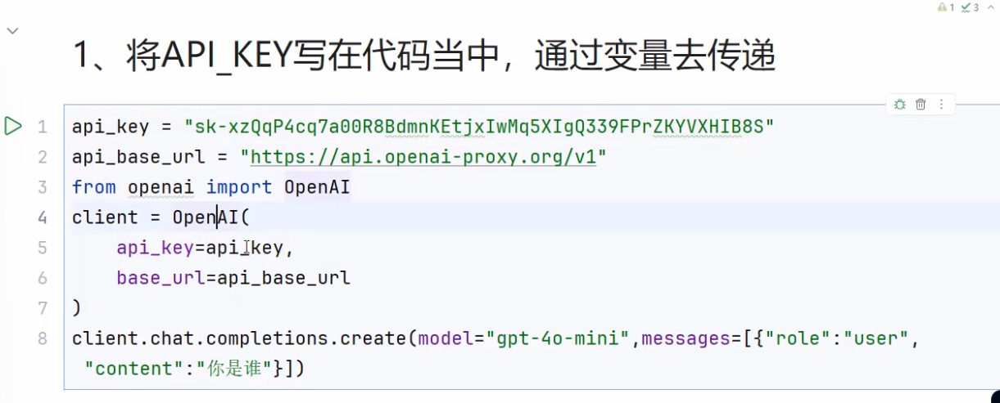
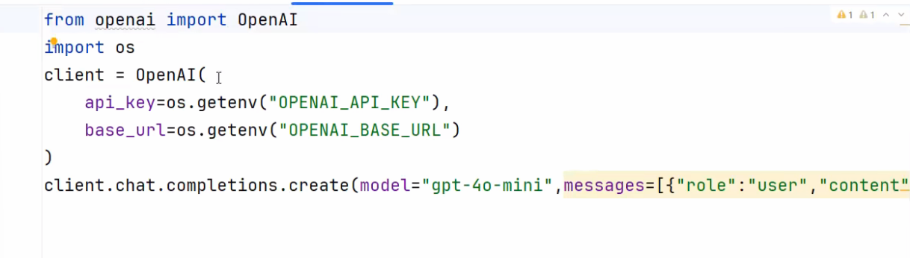
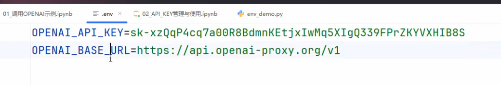

LangChain是专注于可靠代理快速搭建与部署的工程综合平台，包含两个开源框架Langchain和Langgraph，一个闭源工程平台Langsmith

**LangChain = 让大模型能"动手干活"的框架**

功能：搭建agent，问答系统，对话机器人，文档搜索系统

它构建了LLM英勇的全套工具集，涉及到prompt构建，LLM接入，记忆管理，工具调用，RAG，Agent开发等模块

Langchain对于LLM，类似于Spring对于Java，FastApi对于Python

# RAG：

需要补充数据 Rag

对接其他系统 Function Calling
尝试微调 用历史数据做Fine-tuning

# 核心组件：

## Model I/O

输入，处理，输出三个步骤

CloseAI：一个代理商

### API KEY的管理与使用：

#### 1.直接写在代码里面



#### 2.将API KEY，Base URL配置到环境变量里面，通过读取环境变量的方式来读取配置



#### 3.通过配置文件来配置，在代码当中加载配置文件

`import dotenv #可以加载.env文件中的环境变量 `

`import os `

`dotenv.load_dotenv() `

`os.environ["OPENAI_API_KEY"] = "sk-xxxxx"`



### 对话模型的messages

**对话模型的输入可以是文本提示、消息提示或是字典格式。**

#### 1.文本提示

文本提示是字符串，适用于不需要保留对话历史的直接生成任务。

resp = llm.invoke("你好")

#### 2.消息提示

将消息对象列表输入模型，方便管理对话历史，包含系统指令以及处理多模态数据。

**messages = [**

****    SystemMessage("你是个诗人"),****

****    HumanMessage("写首关于春天的诗"),****

**]**

**resp** = **llm**.**invoke**(**messages**)

#### 3.字典格式

也可以按照 OpenAI 聊天补全格式创建字典列表组成消息。一条消息通常包含 role（角色）、content（内容）、metadata（元数据）。

**messages** = [

**    {**"role"**: **"system"**, **"content"**: **"你是个诗人"**},**

**    {**"role"**: **"user"**, **"content"**: **"写首关于春天的诗"**},**

**]**

**resp** = **llm**.**invoke**(**messages**)

**消息类型**

| **消息类型**      | **描述**                                                                                                   |
| ----------------------- | ---------------------------------------------------------------------------------------------------------------- |
| **SystemMessage** | **代表一组初始指令，用于引导模型的行为。可以使用系统消息来设定语气、定义模型的角色，并建立响应的指导方针** |
| **HumanMessage**  | **表示用户输入**                                                                                           |
| **AIMessage**     | **模型生成的响应，包括文本内容、工具调用和元数据**                                                         |
| **ToolMessage**   | **表示工具调用的输出**                                                                                     |

**HumanMessage、AIMessage 和 SystemMessage 是常用的消息类型。**

**ToolMessage 是在工具调用场景下才会使用的特殊消息类型。**

### 多种调用方式

#### 1.流式调用，非流式调用

非流式调用：03文件里面的都是非流式调用，他会有一个具体的结果并打印

流式调用：返回的是一个生成器，他并没有拿到结果，需要迭代结果

```python
result = model.stream("你好，我是谁")
for chunk in result:
    print(chunk.content)
```

#### 2.批次调用，非批次调用

```python
 #批次调用，返回的结果是一个列表，列表中的每个元素是一个消息对象
messages = [
[
 {"role": "system", "content": "你是一位诗人"},
 {"role": "user", "content": "写一首关于春天的诗"},
],
[
 {"role": "system", "content": "你是一位诗人"},
 {"role": "user", "content": "写一首关于夏天的诗"},
],
[
 {"role": "system", "content": "你是一位诗人"},
 {"role": "user", "content": "写一首关于秋天的诗"},
 ],
]
resp = model.batch(messages) # 批量调用,返回一个消息列表

print(resp[0].content) # 打印第一个消息的内容
```

#### 3.同步调用，异步调用

`并行调用，返回的结果是一个列表，列表中的每个元素是一个消息对象`

```python
#异步调用
start_time = time.time()
resps = asyncio.run(async_invoke())
print(resps)

end_time = time.time()
print(f"Total time: {end_time - start_time}"
```

##### asyncio

```python
import asyncio

# 协程适用于I/O密集型任务。CPU密集型任务不适用，
# I/O密集型：等待数据传输的任务，比方说http请求（调用大模型API时，就是发送一个HTTP的一个请求），比方说传输文件，接收文件
# CPU密集型任务：数学计算，图像处理，加密计算，这些任务会一直占用CPU计算能力
async def func1():
    print("func1 开始")
    # I/O 等待场景
    await asyncio.sleep(3)
    print("func1 结束")

async def func2():
    print("func2 开始")
    await asyncio.sleep(5)
    print("func2 结束")

async def func3():
    print("func3 开始")
    await asyncio.sleep(10)
    print("func3 结束")

async def main():
    await asyncio.gather(func1(),func2(),func3())
import time
start_time = time.time()
# 底层通过一个事件循环方式去维护多个协程，最终的运行时间，取决于耗时最长的任务
asyncio.run(main())
end_time = time.time()
```

## 调用本地模型

### Ollama

Ollama官方地址：[https://ollama.com](https://ollama.com)

Ollama Github开源地址：[https://github.com/ollama/ollama](https://github.com/ollama/ollama)

### PromptTemplate

#### 是什么？

模板化的字符串，我们可以将变量插入到模板中，从而创建出不同的提示

#### 什么是langchain中的PromptTemplate？

```python
from langchain_core.prompts import PromptTemplate
template = PromptTemplate(
    input_variables=["product"],
    template="Describe the product: {product}"
)
print(template.format(product="LangChainlallala"))
```

## * Chains

## * Retrievals

## *  Agents
